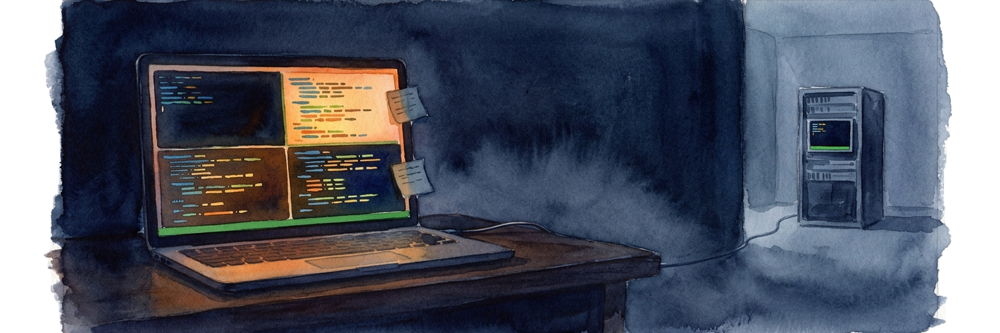
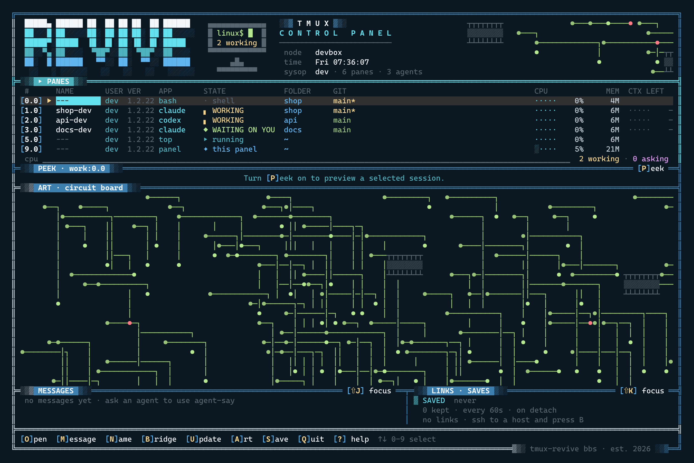

# tmux-revive

Turn your computer off and on, type `tmux`, and it's all back. Your AI agents too.
Claude Code and Codex pick up right where they left off.

## Install

On Linux and macOS:

```sh
curl -fsSL https://raw.githubusercontent.com/odysseyalive/tmux-revive/main/install.sh | sh
```

On Windows, in PowerShell (it installs into WSL, since tmux doesn't run on Windows itself):

```powershell
irm https://raw.githubusercontent.com/odysseyalive/tmux-revive/main/install.ps1 | iex
```

The installer checks for tmux first. If it's missing, it tells you how to get it.

## Start tmux

```sh
tmux
```

That's it. It saves on its own from here on.

## Open the panel

I wanted one screen that shows every pane and every agent. Inside tmux, run:

```sh
tmux-revive panel
```

There's nothing to compile. The installer grabs the panel built for your system, and where that won't run, it falls back to the shell version.



Press [?] for the help page. It's a good place to start. Turn [P]eek on to preview the selected session.

## Get your agents talking

I like my agents working together. Any session can talk to any other, even across Claude accounts, or between Claude Code and Codex.

1. Select a session in the panel and [N]ame it, say shop-dev.
2. In any other session, mention it by name: "Ask shop-dev to run the tests and tell me what fails."
3. When one session asks to talk to another, [G]rant access in the panel.

You can also send any session a [M]essage from the panel. When a session asks a question, press [Enter] and answer it from the peek.

## Talk to your servers too

Got agents on a remote server? I wanted mine right here with the rest.

1. Open another terminal and ssh into the server.
2. Install tmux-revive there too, then start tmux.
3. Back in the panel, [B]ridge it so its sessions show up.

As long as tmux keeps running there, its windows stay in the panel, even after you close that terminal.

[U]pdate it everywhere at once. Sessions running as another user may need updating by hand.

Every other command, key and setting is in [docs/COMMANDS.md](docs/COMMANDS.md).
