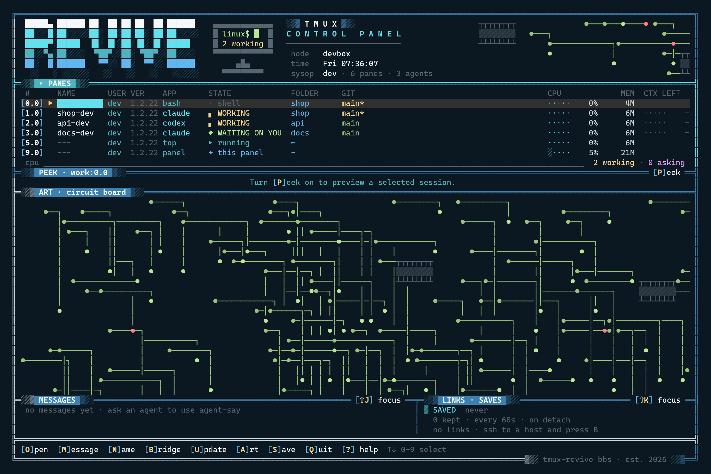

# tmux-revive

Turn your computer off and on, type `tmux`, and it's all back. Your AI agents too.
Claude Code, Codex, Cursor Agent and Crush each pick up right where they left off.

## Install

On Linux and macOS:

```sh
curl -fsSL https://raw.githubusercontent.com/odysseyalive/tmux-revive/main/install.sh | sh
```

On Windows, in PowerShell (it installs into WSL, since tmux doesn't run on Windows itself):

```powershell
irm https://raw.githubusercontent.com/odysseyalive/tmux-revive/main/install.ps1 | iex
```

The installer checks for tmux first. If it's missing, it stops and tells you how to get it on your system.

## Start tmux

```sh
tmux
```

That's it. It saves on its own from here on, so go ahead and poke around.

## Open the panel

I wanted one screen that shows every pane and every agent. Inside tmux, run:

```sh
tmux-revive panel
```



Press [?] any time for the help page. It's a good place to start exploring. Turn [P]eek on to preview a selected session.

## Get your agents talking

I like my agents working together. Revive lets any AI session talk to any other, even across different Claude accounts, or different AI interfaces like Claude Code and Codex.

1. Select a session's Tmux pane in the panel and [N]ame it, say shop-dev, so other code sessions can reference it.
2. In any other session, just mention it by name: "Ask shop-dev to run the tests and tell me what fails."
3. When one code session requests to talk to another, [G]rant access in the panel.

You can also send a [M]essage to any connected code session right from the panel. When a code session asks a question, press [Enter] and answer from the peek window.

## Talk to your servers too

Got agents on a remote server? I wanted mine right here with the rest.

1. Open another terminal and ssh into the server.
2. Install tmux-revive there too, then start tmux.
3. Back in the panel, [B]ridge it so that its code sessions are discoverable.

As long as tmux keeps running there, its windows show up right here in the panel, even after you close that terminal.

[U]pdate Revive on all open sessions. Some user sessions require a manual update.

## Tame Your AI

I built [Claude Workforce](https://github.com/odysseyalive/claude-workforce) because I wanted my AI to get more done, and to show its work. Press [?] in the panel to install it.

## playwright-mcp

I wanted Claude to browse the web the way I do. [playwright-mcp](https://github.com/odysseyalive/playwright-mcp) gives it a real browser in every project.

Every other command, key and setting is in [docs/COMMANDS.md](docs/COMMANDS.md).
