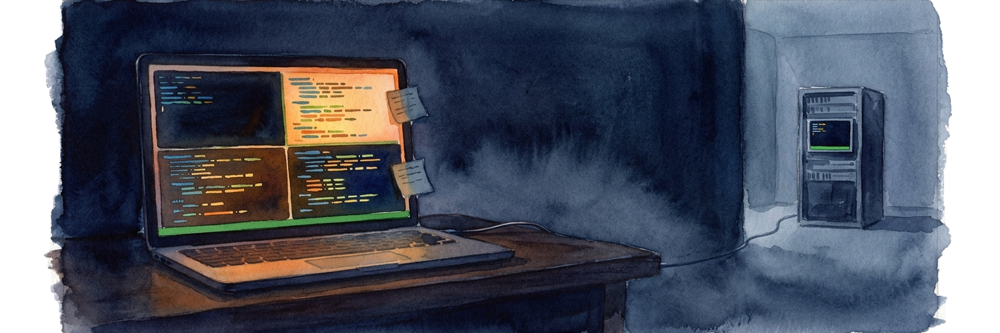

# tmux-revive

The idea is simple. You shut your computer down, turn it back on, type
`tmux`, and everything is right where you left it. Your sessions, windows and
splits all come back with the programs that were running in them. And your AI
coding agents? They pick up **the exact conversation** they were in, too. That
covers Claude Code (Remote Control link and all), Codex, Cursor Agent and Crush.

There's a little extra in the box, too, called `agent-say`. It lets those
agents send each other messages, even across accounts and across computers.

## Contents

- [Install](#install)
- [Everyday use](#everyday-use)
- [Handy commands](#handy-commands)
- [Control panel](#control-panel)
- [Agents talking to each other](#agents-talking-to-each-other)
- [Linking AI sessions across multiple computers](#linking-ai-sessions-across-multiple-computers)
- [Options](#options)

## Install

On Linux, macOS or WSL:

```sh
curl -fsSL https://raw.githubusercontent.com/odysseyalive/tmux-revive/main/install.sh | sh
```

On Windows, in PowerShell (it installs into WSL):

```powershell
irm https://raw.githubusercontent.com/odysseyalive/tmux-revive/main/install.ps1 | iex
```

That's it. If tmux is already running, it's protected from now on. The
installer backs up every file before it touches it, and `tmux-revive uninstall`
undoes all of it.

### Signed releases

The installer installs the latest release, and only after checking it: the
release's `SHA256SUMS` must carry a signature from the release key written
into `install.sh` itself, and the tarball must match it. If anything doesn't
check out it stops, installs nothing, and says why. It never falls back to
something unchecked. The check uses `ssh-keygen -Y verify` (OpenSSH 8.1 or
later).

To install a particular version, pin it:

```sh
curl -fsSL https://raw.githubusercontent.com/odysseyalive/tmux-revive/main/install.sh | REVIVE_VERSION=1.0.0 sh
```

To follow `main` instead, set `REVIVE_REF=main` (or a branch, tag or commit).
That isn't signed: it trusts HTTPS and the GitHub account, and installs the
exact commit the branch pointed at.

## Everyday use

There's nothing new to learn. Work in tmux the way you always have, detach or
close the terminal, shut down, and when you come back, type `tmux`. Everything
reopens.

With one session, `tmux` attaches it. With several, it lists them first: pick
one with the arrows or its number and press Enter, or press `n` for a new one.
`x` closes the highlighted session (Space marks several), and `a` closes all
the others and continues in this one. A session with an agent running in it
asks you to type `yes`, since closing it ends that conversation.

It saves on its own when you detach or close something, every minute if
anything changed, and on Linux right before shutdown or sleep.

Want a clean slate? Close the panes, windows or sessions yourself. What you
close stays closed.

## Handy commands

What would come back right now:

```sh
tmux-revive status
```

Every save, newest first:

```sh
tmux-revive list
```

Bring back an older save (use a name from `list`):

```sh
tmux-revive restore 20261106T192239
```

Check that everything is working:

```sh
tmux-revive doctor
```

Install the latest version (your saves are kept):

```sh
tmux-revive update
```

It shows the version it moves from and to, and checks the new release against
the key in the copy you already have. `tmux-revive update --version 1.2.3`
installs that release (going back is allowed only this way), `tmux-revive
update --main` follows `main` unsigned, and `tmux-revive version` shows what's
installed and where it came from.

Remove it (add `--purge` to also delete your saves):

```sh
tmux-revive uninstall
```

## Control panel

Remember the old BBS screens? This is a live one for every pane. It shows
what's running in each, and whether each AI agent is working, waiting on you,
or stuck on a question before it can go on. CPU, memory and git status are
there too, along with recent agent messages, links and saves.

**CTX LEFT** shows how much of each agent's context window is still free,
green, then yellow at 40% and red at 15%. It reads Claude Code's and Codex's
own session records; other agents show a dash. Claude Code doesn't record its
window size, so the panel takes a million tokens for models that have one and
200k otherwise. Set `REVIVE_CLAUDE_WINDOW` to override it.

```sh
tmux-revive panel
```

Each pane is numbered the way tmux's status bar numbers it, window then pane:
`[3.1]` is pane 1 in window 3. Press a window's number to go to its first pane,
or pick any pane with the arrow keys, then press a letter. **J**
jumps to it, **M** messages it, **N** names it, and **P** shows or hides a
quick peek at its screen. **A** swaps the artwork, **S** saves right now, and
**Q** quits. **X** spreads the peek over the artwork too, and **C** puts it back.

When the selected agent is asking a question, the peek shows the question instead.
Press **Enter** to answer it right there: your keys go to the agent as if you were in
its pane, typed answers included, until it has its answer or you press **Ctrl-]**. For
a chat with the agent, **J** takes you to its pane.

When a pane ssh's into another computer, the panel spots it and offers to link
the agents there: **L** links it (after showing you the computer's host key to
confirm, and a popup for its password if it takes one), **U** unlinks. Once linked, that computer's panes show up in the list too,
grouped under its name, with the version of tmux-revive it runs. If that's older than
yours, its heading says `out of date`: select one of its panes and press **V** to update
it over ssh, after a yes. **N** names one of its panes the same way, over ssh.
**J** on one of its panes jumps to your pane that's ssh'd into that computer, and
has tmux over there switch to the pane you picked. If your ssh runs in a terminal
outside tmux, the panel can't focus that terminal, but tmux over there still switches.
That takes an up-to-date tmux-revive over there, which **V** sees to.

You don't need the panel open to hear about questions: when any agent starts asking
one, tmux shows a message naming the pane and rings the bell, once per question.

Every time it opens, one of five pieces of old-school ANSI art fills whatever
space is left over, sized to your pane.

## Agents talking to each other

`agent-say` lets an agent in one tmux pane send a message to an agent in
another pane, and the answer finds its way back on its own.

First, give each pane a name. You only do this once. In Claude Code, type this
into its prompt:

```
! agent-say name shop-dev
```

Pick a name that won't get mixed up with what the agents are talking about.
Send a message to `api` or `tests` and it reads like just another topic in
the conversation, and `claude` could be any Claude pane at all. The project
plus the pane's job, so `shop-dev` or `shop-review`, keeps things clear.

Then just ask your agent in plain words:

> Use agent-say to ask shop-review to review parser.py and tell you what breaks.

See every pane and its name:

```sh
agent-say list
```

Read the last five messages:

```sh
agent-say read 5
```

A word of caution. Anything that can run `agent-say` can type into your
agents, so treat it the way you'd treat access to your terminal.

## Linking AI sessions across multiple computers

Link tmux on your computer to tmux on a server, and the agents on both sides
can talk to each other by name. Run this once on **your own computer**, using
the same name you'd type after `ssh`:

```sh
agent-say link devbox
```

The server needs `agent-say` installed too. With an ssh key, the link logs in on
its own. A server that only takes a password works as well: ssh asks you for it
once (in a small popup when you press **L** in the panel), and the link keeps that
connection open. tmux-revive never sees or stores the password, and ssh only asks
for it once the server has shown the host key you confirmed. If the connection
drops (that server reboots, or the network goes away for a while), the panel
marks the link `needs login` and **L** asks for the password again. Nothing logs
in again by itself.

The first time, it shows the server's host key fingerprint and asks you to confirm it
(from a script, add `--yes` once you've checked it). If that key changes later, the
link stops and `agent-say link` says so, until you link again and confirm the new one.

You can limit what the other computer may do here:

```sh
agent-say link devbox --read-only        # its messages wait in the mailbox, never typed in
agent-say link devbox --allow shop-dev   # its messages may reach only these panes
```

`--read-write` and `--allow-all` undo those, and `agent-say link` on its own lists
your links with their key and limits.

Then send by name, the same as before:

```sh
agent-say shop-review "run the tests and tell me what fails"
```

If a name exists on both sides, add the computer:

```sh
agent-say shop-review@devbox "run the tests"
```

Stop a link:

```sh
agent-say unlink devbox
```

Link to two servers and your computer passes messages between them. Each server
sees the other's panes in `agent-say list` (as `tt-dev@dev  (via laptop)`), and
a plain name works as long as only one pane anywhere has it.

The first time an agent on one server writes to an agent on the other, the
message waits on your computer as an introduction. The other server gets
nothing until you allow it: press **I** in the panel, read who's asking and why,
and pick yes or no. Yes shows a four-digit code in a popup to type back, then
delivers the introduction and anything sent since, in order, and the two can
talk both ways. No drops them, and that
agent can't write to that one again. Permission is per pair of agent sessions,
so a new session in a pane asks again, and **I** also lists what you've allowed,
to revoke. The sending agent is told plainly what happened (`introduction sent`,
`held`, `declined`). At most 5 messages wait per pair and 3 introductions per
server, and one nobody answers lapses after a day. `agent-say intros` lists them
from a terminal.

A message from another server is never typed into the agent's prompt as if you
had written it: the agent is told one is waiting and reads it with
`agent-say show`, marked as coming from another agent, not from you.

What this does and doesn't protect: agents on your servers can't allow anything,
since they can't touch your computer's files, so a rogue server can't reach
your other servers' agents without you. Your computer names each sender's server
itself, from the link it came in on. Within one server, though, an agent's
session is what that server says it is: a rogue process there could pass for
another agent on the same server, but only one that is still running under the
same pane name, and only to the agents you allowed that one to reach. Agents on your own computer run as you,
though, and a determined one could get round the popup. Every permission given
is logged with what gave it (`agent-say intros` shows them). For real isolation
on your computer, deny agents `tmux send-keys` and writes under
`~/.local/state/agent-say` (in Claude Code, a `permissions.deny` rule such as
`Bash(tmux send-keys:*)`), or run them as another user.

Your computer and both servers need this version. What a server sends through
your computer also follows its own link's limits: `--read-only` holds it in
your mailbox, and an `--allow` list must name the far pane as `tt-dev@dev`.

## Options

Options go in your tmux config, **before** the tmux-revive block. The one
you'll most likely want is the number of seconds between saves:

```tmux
set -g @revive-interval 60
```

Want the panel to pop up with a key? This one uses prefix + P:

```tmux
set -g @revive-panel-key P
```

Besides AI agents, a pane comes back running the program it had open if that
program is on this list (the default is shown, the panel included). Add your
own to it, or set it to `:all:` to relaunch anything. It's a list because
relaunching a build, a `git push` or an `rm` after a reboot would run it again:

```tmux
set -g @revive-programs 'vim nvim vi man less more tail top htop btop watch ssh mosh journalctl lazygit lazydocker yazi ranger k9s tmux-revive'
```

Turn off the alert when an agent asks a question, or just its bell:

```tmux
set -g @revive-question-alert off
set -g @revive-question-bell off
```
